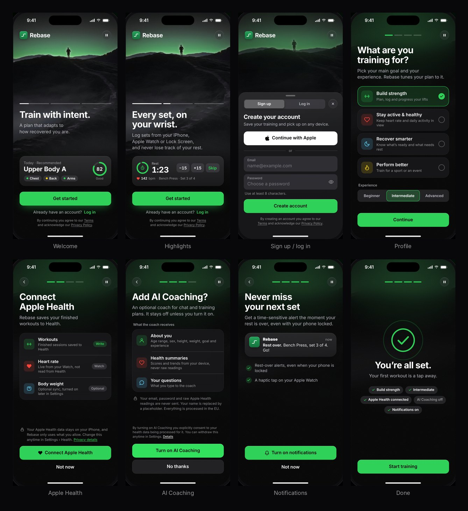

# Rebase · onboarding & login (design prototype)



A clickable prototype of the new first-run experience, built around the looping runner video:
**welcome → sign up / log in → profile → Apple Health → AI Coaching → notifications → done**.
It is the design reference for the SwiftUI onboarding in `ios/` ([ported](#the-swiftui-port)). Nothing is sent or stored; the forms are not connected to anything.

## Open it

| | |
|---|---|
| Web (after merge) | `https://pulse-health.github.io/design/` |
| Locally | from the repo root `npx http-server -p 8080`, then <http://localhost:8080/design/> (opening `design/index.html` straight from disk works too) |
| On a phone | full bleed like the app, with real safe areas. On a desktop it sits in a device frame with a panel to jump between screens |
| Deep links | `#welcome` `#signup` `#login` `#profile` `#health` `#coach` `#notify` `#done`, plus `?lang=de` (otherwise the browser language decides) |

GitHub Pages publishes this folder like the rest of the repo (the page is `noindex`). To keep it off the site, add `design` to `exclude` in `_config.yml`, the way `ios` is.

## Files

```
design/
  index.html         structure and the icon sprite
  styles.css         tokens + components (dark only)
  app.js             copy (EN / DE), flow, video, pager, sheet, form
  assets/hero.mp4    the runner loop (704 x 1280, 14 s, 1.4 MB, no audio track)
  assets/hero-poster.jpg
  tools/encode-hero.sh   turns a generated clip into those two files
  preview.jpg        overview used above
```

## Design decisions

- **One clip behind everything.** It plays on the welcome screen and above the sign-up sheet. Behind the setup steps it is darkened, blurred and paused, because its motion would barely show there. The glow was graded from the clip's lime to the app's green `#30D158`, so video and UI share one accent.
- **Dark only.** The video is the surface, so onboarding ignores the light appearance. Everything after onboarding keeps following the system.
- **Welcome.** Three story-style highlights (6.5 s each; tap or swipe, hold to pause), each with a preview made from the app's own components (see below). One primary action; "Log in" is a text link.
- **Sheet.** Sign up / Log in segmented control, Continue with Apple, email and password with inline validation, drag to dismiss. 26 pt top radius like the app's sheets.
- **Setup.** Profile (main goal, experience), Apple Health priming, AI Coaching consent, rest-over notifications, then a summary of the answers.
- **Consent is not a dark pattern.** AI Coaching is off unless turned on. "Turn on" and "No thanks" are the same size and weight. The copy lists what is and is not shared.

### Tokens

CSS variables use the dark values of `ios/Packages/PulseStrengthKit/Sources/PulseStrengthIOS/PulseTheme.swift`, in kebab-case.

| CSS | `PulseTheme` | Value |
|---|---|---|
| `--ground` · `--card` · `--cell-fill` | `ground` · `card` · `cellFill` | `#000` · `#1C1C1E` · `#2C2C2E` |
| `--chip-fill` · `--separator` | `chipFill` · `separator` | `#767680` @ 24 % · `#545458` @ 65 % |
| `--ink` · `--ink-secondary` · `--ink-tertiary` | same | `#FFF` · `#98989D` · `#636366` (the app's own dark `inkTertiary` became `#98989D` in its contrast audit; the onboarding keeps `#636366` for the label of a disabled button only, where no contrast is required) |
| `--green` · `--green-tint` · `--on-green` | `green` · `greenTint` · `onGreen` | `#30D158` · `#30D158` @ 18 % · `#000` |
| `--heart` | `heart` | `#FF453A` (heart rate only) |
| `--recovery-good / -fair / -low` | `recoveryGood / Fair / Low` | `#30D158` · `#FFD60A` · `#FF453A` |
| `--pr-fill` · `--pr-text` | `prFill` · `prText` | `#FFD60A` @ 24 % · `#FFD60A` |
| `--card-radius` · `--list-radius` · `--sheet-radius` | `cardRadius` · `listRadius` · `sheetRadius` | 20 · 12 · 26 |

Only in this prototype (not in `PulseTheme`): `--hero-inset` 24 pt, the on-video text colours, the glass fill and blur, and `--destructive-text` `#FF6961` (error text; `#FF453A` is 4.1 : 1 on the sheet, this is 4.9 : 1). Buttons are 52 pt with a 14 pt radius; the hub's primary button is 50 pt / 12 pt continuous, which reads about the same.

### What the previews mirror

| Preview | App component |
|---|---|
| Today's plan: eyebrow, template name in rounded numerals, muscle chips, ring | `HubRecommendedCard`, `HubReadinessRing` in `StrengthHubView.swift` (ring colour: 80+ good, 60+ fair, else low) |
| Rest timer and live heart rate | `RestDockView` (ring, "Rest", 30 pt rounded countdown, −15 / +15 / Skip) |
| New PR | PR pill (`prFill` / `prText`) |

## Video

`tools/encode-hero.sh path/to/clip.mp4` rewrites `assets/hero.mp4` and `assets/hero-poster.jpg`:

- **Loops without a jump.** The last second is cross-faded into the first (the generated clip's first and last frames differ). `FADE_FRAMES=24` is the best trade-off here; longer fades show a ghost of the runner.
- **Grade.** `hue=h=36:s=1.45` plus a touch of contrast moves the glow to the brand green. `GRADE=""` keeps the original colours.
- **Small.** H.264, `faststart`, no audio, so it never interrupts the user's music. `CRF=21` gives 1.4 MB.
- The source is 704 × 1280, which phones upscale about 3×. The dark, misty picture hides it, but a 1080 × 1920 export would be sharper.
- **Poster** (a frame where the runner stands in the centre) shows while loading, with reduced motion, with Data Saver on, or when the browser blocks autoplay.

Motion rules: a pause button is always on screen; "reduce motion" shows the poster and stops auto-advance; a hidden tab pauses everything. The panel's "Preview reduced motion" switch simulates the system setting.

## The SwiftUI port

The flow is implemented in `ios/Packages/PulseStrengthKit` (see [`ios/README.md`](../ios/README.md#onboarding-first-run)); this page stays the visual reference.
`app.js` is also the source of the Swift copy: `OnboardingCopyTables.swift` is generated from its `STRINGS`, so change a word here first.

| Prototype | SwiftUI |
|---|---|
| `STRINGS` (EN / DE) | `OnboardingCopy*.swift` (Core): one exhaustive `switch` per language |
| `go()` / `state` | `OnboardingReducer` + `OnboardingModel` (Core, unit-tested on Linux) |
| video + poster + `.media__grade` + `.media__veil` | `OnboardingBackdrop`: `AVPlayerLooper` in an `AVPlayerLayer`, two gradients, a material veil |
| pager, slides, previews | `OnboardingWelcomeView` + `HighlightPlayback` (the clock) + `OnboardingProofCards` |
| sheet | a system `.sheet` (`OnboardingAuthSheet`) with a measured first detent (at least 540 pt, so the whole form shows), 26 pt radius, material background |
| profile / health / coach / notify / done | `OnboardingSetupScreens`, `OnboardingDoneView`, on `OnboardingSetupLayout` |
| `--*` tokens | `OnboardingTheme` (the dark values of `PulseTheme` as fixed colours) |

Where it differs on purpose:

- **Sheet.** A system sheet instead of the hand-drawn one, so the keyboard, the drag to close and VoiceOver's escape work as everywhere in iOS.
- **No film grain, no iOS 26 glass.** The grain only hides banding in the browser; the app targets iOS 17, so the glass is `.ultraThinMaterial` plus a light edge.
- **Permissions are real.** "Connect Apple Health" and "Turn on notifications" show the system prompts; the answer in the system sheet is what the summary chip says.
- **Errors the prototype never had.** Wrong password, an existing account and no connection have their own messages (`OnboardingCopy.authMessage(for:)`).
- **Log in ends the flow** instead of toasting "Logged in" and restarting; the setup steps are only for new accounts.
- **Audio session untouched.** The clip has no audio track, so it cannot interrupt music; no `AVAudioSession` category is set.
- **Sign in with Apple** goes through the account service (`authenticateWithApple`). The button looks like Apple's but is not `SignInWithAppleButton` yet: that needs the capability and the provider (open item 3).

## Decisions and open items

1. **Name and logo.** The product is now Rebase. The mark (a low line stepping up to a higher one) is a placeholder on the app icon's green gradient; `AppIcon.png` in `ios/` is still the green dumbbell.
2. **Legal pages still say Pulse.** The sign-up text links the existing `terms.html`, `privacy-policy.html`, `agb.html` and `datenschutz.html`. They, and the site's `index.html` / `index-en.html`, need the same rename when it goes public.
3. **Continue with Apple.** The privacy policy (§6, Clerk) mentions email sign-in only. Offering Apple means enabling the provider in Clerk and updating §6. If it is not offered, remove the button and the "or" divider.
4. **Consent copy.** The AI Coaching step is derived from privacy policy §7 ("explicit consent during onboarding", EU processing, what is and is not sent). Whoever owns the legal text should review it before it ships.
5. **Not designed:** preferred name (the policy sends it as a placeholder), coaching style and the free-text limitation notes the policy lists, the separate medication consent.
6. **Health rows** follow what the app really asks for: it saves finished workouts to Health (the one permission the step requests), body weight is an optional sync that is turned on later in Settings, and the heart rate comes from the Watch, not from Health. If the app starts reading more, this step and the Info.plist strings change together.
7. **German** is a proposal in the same informal "du" as `datenschutz-einfach.html`.
8. **Fonts.** SF Pro on Apple devices; other platforms fall back to Inter, Segoe UI or Roboto.

## What was checked

Chromium via Playwright (with a WebM copy of the clip, because that build has no H.264): 58 automated checks of behaviour, keyboard flow (open, Escape, focus return), validation, language switch and reduced motion; no overflow on all 8 screens in both languages; axe-core finds no violations; text contrast over six frames of the loop is at least 4.99 : 1 (axe cannot judge text over video, so this was measured from pixels). Layouts were also rendered full-bleed at iPhone 15 Pro, Pro Max and SE sizes.

**Not tested:** Safari and real devices, VoiceOver, the on-screen keyboard, Low Power Mode autoplay.
